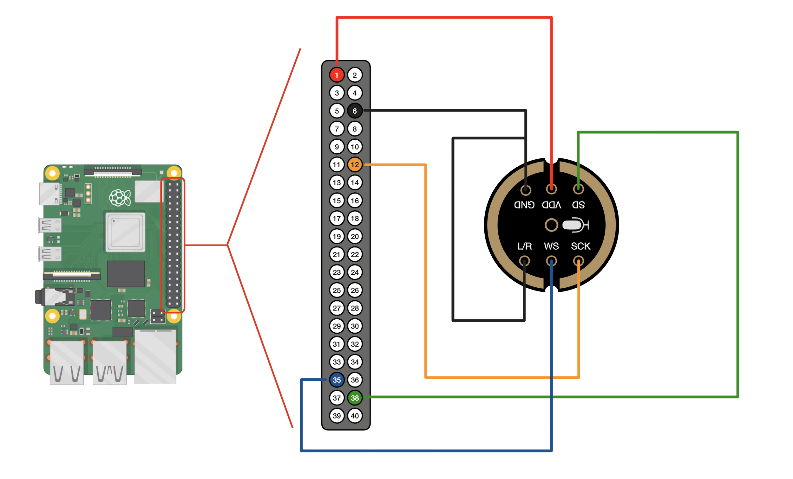
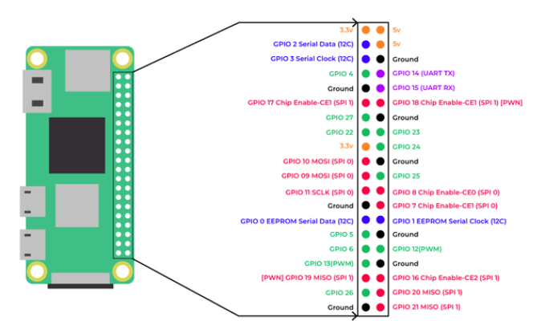

# SmartFrame

Raspberry Pi Zero 2 powered smart display with two modes: a Magic Mirror (Chromium kiosk via MagicMirror²) and a real-time audio spectrum analyzer & decibel meter (pygame + PyAudio). Modes are switched remotely via MQTT, with native Home Assistant integration.
Designed for a 14" matte LCD to mimic an e-ink aesthetic.

## Hardware

- **Raspberry Pi**: Zero 2 WH or newer.
- **Screen**: 13.3" or 14" IPS Matte LCD (1920x1080) with HDMI controller board.
- **Audio**: INMP441 Microphone (I2S) for digital audio capture.

## Microphone Wiring (Pi Zero 2 WH <-> INMP441)

To connect the INMP441 I2S microphone to your Raspberry Pi, follow the wiring table below or the visual diagram:

| INMP441 Pin | Raspberry Pi Pin (Physical) | GPIO Pin | Function             |
|:------------|:----------------------------|:---------|:---------------------|
| **VDD**     | Pin 1 (3.3V)                | -        | Power                |
| **GND**     | Pin 6 (GND)                 | -        | Ground               |
| **L/R**     | Pin 9 (GND)                 | -        | Channel Selec (Left) |
| **SCK**     | Pin 12                      | GPIO 18  | Serial Clock         |
| **WS**      | Pin 35                      | GPIO 19  | Word Select          |
| **SD**      | Pin 38                      | GPIO 20  | Serial Data          |





## Screenshots


## Linux Prerequisites (Raspberry Pi OS)

1. **Enable I2S Microphone**: Update `/boot/firmware/config.txt`:

   ```ini
   dtparam=i2s=on
   dtoverlay=googlevoicehat-soundcard
   ```

2. **Enable GPU Acceleration**: Ensure the KMS overlay is active in `/boot/firmware/config.txt`:

   ```ini
   dtoverlay=vc4-kms-v3d
   gpu_mem=32
   ```

   With `vc4-kms-v3d`, the screen, the audio mode and the browser draw with memory that Linux manages (CMA). `gpu_mem` only reserves memory for the firmware's video decoder and camera, which SmartFrame does not use, so a low value leaves more RAM for Linux. `scripts/setup_memory.sh` sets it for you (see [Performance Optimization](#performance-optimization-pi-zero-2-wh)). Raise it again (e.g. `gpu_mem=64`) only if you add hardware video decoding, such as a MagicMirror module that plays videos.

3. **Configure Screen**: Adapt to your needs:

```ini
# Forces HDMI and resolution 1080p 60Hz
hdmi_force_hotplug=1
hdmi_group=2
hdmi_mode=82
```

or force the kernel by adding into `/boot/firmware/cmdline.txt`:

   ```ini
   video=HDMI-A-1:1920x1080M@60
   ```

4. **Power Management Tools**: To ensure the screen shuts off immediately (avoiding the "No Signal" delay), install CEC and DDC utilities:

   ```bash
   sudo apt update
   sudo apt install -y cec-utils ddcutil
   ```

*(A reboot is required after applying these changes).*

## Performance Optimization (Pi Zero 2 WH)

The Pi Zero 2 WH has limited RAM (512MB). When it runs out, the Pi swaps to the SD card, which is very slow: the Mirror mode can then take minutes to show its modules. Use **zram** (compressed swap in RAM) as the main swap: it is fast and does not wear out the SD card. A small swap file on the SD card is only a safety net for rare peaks.

`./scripts/setup_memory.sh` (offered by `setup_pi.sh`) does all of this, and is safe to run again:

- sets `gpu_mem=32` (see [Raspberry Pi configuration](#linux-prerequisites-raspberry-pi-os)), backing up `config.txt` first;
- starts a zram swap (half of the RAM, zstd) unless one is already active;
- sets `vm.swappiness=100` (in `/etc/sysctl.d/99-smartframe-zram.conf`), so the Pi uses zram early instead of waiting until RAM is full.

Reboot afterwards for `gpu_mem` to apply. To do it by hand instead:

```bash
# 1. Check what you have. Recent Raspberry Pi OS versions already set up zram
#    (a /dev/zram0 line): then skip step 2.
swapon --show

# 2. zram, about half of the RAM, compressed with zstd
sudo apt install -y systemd-zram-generator
printf '[zram0]\nzram-size = ram / 2\ncompression-algorithm = zstd\nswap-priority = 100\n' \
  | sudo tee /etc/systemd/zram-generator.conf
sudo systemctl daemon-reload && sudo systemctl start systemd-zram-setup@zram0
echo 'vm.swappiness=100' | sudo tee /etc/sysctl.d/99-smartframe-zram.conf
sudo sysctl -p /etc/sysctl.d/99-smartframe-zram.conf

# 3. Optional safety net: a small 512 MB swap file, used only when zram is full
#    (lower priority). Skip it if your OS already has a swap file.
sudo fallocate -l 512M /swapfile
sudo chmod 600 /swapfile
sudo mkswap /swapfile
sudo swapon --priority 10 /swapfile
echo '/swapfile none swap sw,pri=10 0 0' | sudo tee -a /etc/fstab
```

GPU use: the audio mode asks SDL2 for its GLES2 renderer when the Pi has a GPU (`/dev/dri`), and the Mirror mode's main browser (Cog, WPE WebKit) renders with the GPU. The fallback browser (Chromium) runs with `--disable-gpu`: no GL backend works with it on the Pi's `vc4` driver, so it renders in software.

## SmartFrame Installation

```bash
git clone https://github.com/Perhan35/smart-frame.git
cd smart-frame
./scripts/setup_pi.sh
```

On some systems (Raspberry Pi Zero 2) the RAM is too low for pip to install the dependencies. In that case, you should create a temporary directory:

```bash
mkdir -p ~/pip_tmp
TMPDIR=~/pip_tmp ./scripts/setup_pi.sh
```

The setup script installs all OS-level dependencies (`portaudio`, SDL2, Chromium, etc.), creates a Python virtual environment (`.venv/`), and installs the Python packages inside it.

## Configuration

The setup script creates `config.yaml` from `config.example.yaml` automatically. Edit `config.yaml` to set your preferences (it is gitignored):

- **MQTT**: Set up your broker IP, port, and credentials. Set `tls: true` (and usually `port: 8883`) if your broker supports TLS; `ca_cert` can point to the broker's CA certificate. See [Security](#security).
  - `device_id`: (Optional) name of this frame. Empty = the Pi's hostname. It replaces `{device_id}` in the topics and is part of every Home Assistant ID, so several frames can share one broker. Changing it (or the hostname) creates new entities in Home Assistant.
- **MagicMirror**: Set the URL corresponding to your local MagicMirror instance.
- **Screen**: `screen_size` (e.g. `"1920x1080"`) is the size the Mirror browser starts with. The audio screen uses the real screen size and scales its layout.
- **`keep_compositor_when_off`**: `true` keeps the compositor (labwc) running in `off` mode, with the screen switched off. The next mode then starts without the 6-8 s cold start, but some RAM stays in use. Default `false`.
- **`restore_display_settings_on_power_on`**: `true` (default) sends the saved brightness, contrast and color profile again each time the screen turns on. If your screen keeps its settings while off, `false` makes switching on faster (fewer DDC/CI commands), but changes made with the screen's own buttons are then no longer undone.
- Invalid values in `config.yaml` (a word instead of a number, an unknown mode...) never stop the frame: they are replaced by their default, with a warning in the log (`journalctl -u smartframe`).
- **Audio Mode**:
  - `threshold_db_warning`: Volume (in dB) where the dB text will turn yellow/orange (default: 60).
  - `threshold_db_error`: Volume (in dB) where the dB text will turn red (default: 85).
  - `device_index`: (Optional) Manual ALSA microphone index. If left blank, the SmartFrame will automatically discover and cache the best device (e.g. INMP441 I2S) for you. When set, it always wins over auto-discovery (`scripts/list_audio_devices.py` helps you pick it).
  - `mic_channel`: `"left"` when the mic's L/R pin goes to GND (as in the wiring above), `"right"` when it goes to 3.3V. On a stereo I2S device only this channel is used (averaging with the silent one would lose 6 dB).
  - `capture_bits`: `16` (default) or `32`. 32 keeps the full 24-bit resolution of the INMP441 (better in very quiet rooms). The calibration stays the same. Go back to 16 if the microphone does not open.
  - `calibration_offset_db`: added to every reading. The default, `33`, is the theoretical value for the INMP441 (datasheet). Fine-tune it as described in [Calibrating the sound level](#calibrating-the-sound-level).
  - `calibration_slope`: (Optional) second calibration point. `1.0` = offset only.
  - `noise_floor_dba`: (Optional) the mic's own noise in dBA, removed from every reading in energy. Set it **after** calibrating, either with `scripts/measure_noise_floor.py` (stop the service first, measure in a very quiet room) or with the INMP441 datasheet value (about 33). Leave it empty for no correction.
  - `show_debug`: `true` (default) shows the CPU stats and the "FAST RESPONSE | SLOPE" line on the audio screen. `false` hides them.
  - `theme`: `"neon"` (default, colors on black) or `"eink"` (ink on paper, monochrome, for the e-ink look). Both use the Barlow font shipped in `assets/fonts/`.
  - `pixel_shift_minutes`: every this many minutes, the whole audio screen moves by a few pixels, so the legend and the numbers do not mark an IPS screen left on all day. Default `10`, `0` turns it off.
  - `preload`: `true` keeps an audio mode process ready in the background (Python, pygame and numpy already loaded) while another mode or `off` is shown. Switching to `audio` is then faster, but that process uses RAM all the time (check with `scripts/perf_report.sh` before keeping it on a Pi Zero 2). Default `false`.
  - `render_scale`: `1.0` (default) draws at the screen's resolution. Lower values draw the bars and the curve smaller and let the GPU scale them up with smoothing, while the text and the legend stay at full resolution (sharp): `0.75` is a good balance (about half the pixels), `0.5` uses the least CPU. Without a usable GPU renderer, the whole image (text included) is scaled.

### Sound level: what the numbers mean

- Home Assistant receives, every second, the **LAeq** of that second (energy average, so a short loud noise between two updates is not missed). Both modes compute it with the same code (`smartframe/dsp.py`), so the sensor does not jump when the mode changes.
- The big number on the audio screen is more reactive (instant rise, short hold), so it can read a little above the Home Assistant value.
- It is a relative dBA: accurate near the calibration point(s), indicative far from them. Readings close to or below `noise_floor_dba` are indicative only.
- Limits: the INMP441 is not flat in frequency (less bass), the reference is often a phone app (itself ±2-3 dB), and the ALSA chain may change the scale. Expect a few dB of error, not a certified sound level meter.
- The spectrum bars have their own visual scale: they do not move when you change the calibration.

### Calibrating the sound level

You need a reference: a sound level meter, or a phone/smartwatch app (set to dBA, "fast" or "1 s" average).

**With the script (easiest):** stop the service (`sudo systemctl stop smartframe`), then run `.venv/bin/python scripts/calibrate.py`. It measures for 15 s, asks what your reference read (its average over the same time), computes the offset (and the slope if you add a 2nd point) and writes them into `config.yaml`. The steps below do the same by hand.

1. **Offset (1 point).** Make a steady sound around 65 dBA (music or a TV at normal volume, or pink noise from a speaker). Put the phone next to the frame's microphone. Compare the phone with the **SmartFrame Ambient Sound** value in Home Assistant (wait 10 s for both to settle). Then:
   `new calibration_offset_db = old value + (phone - SmartFrame)`
   Example: offset 33, phone 64, SmartFrame 60 → offset 37.
2. **Slope (optional, 2nd point).** Only if a quiet or loud level is still off after step 1. Measure a second, different level (e.g. about 40 dBA in a quiet room, or about 85 dBA). Then:
   `calibration_slope = (phone - 65) / (SmartFrame - 65)`
   Example: phone 85, SmartFrame 82 → slope (85 - 65) / (82 - 65) = 1.18. The slope pivots around 65 dBA, so step 1 stays valid.
3. **Noise floor.** Measure it again (`scripts/measure_noise_floor.py`) after changing the calibration.
4. Restart the service: `sudo systemctl restart smartframe`.

> **Note:** The setup script will warn you if `config.yaml` still has placeholder values and skip the service installation prompt until you configure it.

## Usage

Manual startup:

```bash
source .venv/bin/activate
python3 main.py
```

### Going back to a known good version

Before trying something new on the Pi, mark the version that works:

```bash
git tag -f stable          # -f moves the tag if it already exists
```

If an update goes wrong, go back to it, then restart the service:

```bash
git checkout stable
./scripts/install_service.sh   # Only if the service file changed
sudo systemctl restart smartframe
```

`git checkout main` (then `git pull`) returns to the latest version. The tag stays on the Pi: no need to push it.

### Service Installation / Update (Start on Boot)

To install or update the service, run the install script:

```bash
./scripts/install_service.sh
```

This generates the systemd service file from the template (`scripts/smartframe.service`), and installs/starts it. Run it as your normal user, not with `sudo` (it asks for `sudo` itself). After a `git pull` that changes the template, the `post-merge` hook updates the installed unit; if it cannot (password needed), run the script again.

The unit is hardened: the service cannot gain new privileges (`sudo`, setuid) and cannot write system files. If you add a feature that needs more, see the comments in `scripts/smartframe.service`.

Some systemd options are left out on purpose because they break the Mirror mode. Cog (WPE WebKit) locks the part that renders web pages in a sandbox (`bwrap`), and that sandbox stays the most useful protection here. `RestrictSUIDSGID` and `ProtectKernelLogs` both stop it from starting: Cog crashes (exit code 133), is relaunched 3 times, then the frame goes back to `off`. If the Mirror mode goes back to `off` after a change to the unit, look for `bwrap` errors:

```bash
journalctl -u smartframe -n 300 --no-pager | grep -E "bwrap|cog\[|FAIL-SAFE"
```

Set `debug: true` in `config.yaml` (then restart the service) to see the browser messages in the log.

## Universal Display Control (DDC/CI & CEC)

SmartFrame features high-performance hardware display management, allowing it to bypass the slow "No Signal" standby delay and control the monitor's internal settings directly via DDC/CI.

### Core Features

- **Instant Power**: Uses `ddcutil`/`cec-client` to put the monitor into true standby instantly.
- **Hardware Brightness & Contrast**: Direct 0-100% control of the backlighting and contrast ratio.
- **Color Temperature Profiles**: Switch between **Warm (5000K)**, **Natural (6500K)**, and **Cool (9300K)** via MQTT.
- **Input Source Switching**: Electronically switch the monitor between the **Pi (HDMI-1)**, a secondary device (**HDMI-2**), or **DisplayPort**.
- **Settings Persistence**: All display settings are cached and automatically restored when the screen powers on.

### Required Tools

Install the utilities to enable hardware-level control:

```bash
sudo apt update
sudo apt install -y cec-utils ddcutil
```

*Note: The setup script automatically handles group permissions (`i2c`, `video`) for these tools. SmartFrame never calls `sudo` at runtime.*

## Security

SmartFrame is designed to stay safe on an untrusted local network.

- **MQTT credentials**: always set `mqtt.username` / `mqtt.password` and require authentication on the broker. Without them, anyone who can reach the broker can control the frame (a warning is logged at startup).
- **MQTT encryption**: with `tls: false`, the password and all commands travel in clear text. Enable `tls: true` if your broker supports it.
- **Broker ACL**: give the frame its own MQTT user, limited to its own topics (adjust if you changed the topic names). Example for Mosquitto (`acl_file`):

  ```text
  # Home Assistant's own MQTT user keeps full access
  user homeassistant
  topic readwrite #

  # The frame can only use its own topics, publish discovery, and know when HA restarts
  user smartframe
  topic readwrite smartframe/#
  topic write homeassistant/#
  topic read homeassistant/status
  ```

  **Warning:** once an `acl_file` is set, any user not listed in it gets no access at all. List every MQTT user you use (Home Assistant, other devices), or they will stop working. If your broker is managed by a Home Assistant add-on, configure ACLs the way that add-on documents.

- **MagicMirror**: the kiosk browser checks TLS certificates. Serve MagicMirror on the Pi itself, or over HTTPS with a certificate the Pi trusts. Plain HTTP across the network can be modified by anyone on it, and a self-signed certificate shows an error page.
- **`config.yaml`** contains the MQTT password. It is set to `chmod 600` (owner only) by the setup script and at startup.
- **No `sudo` at runtime**: the service uses group permissions only (`i2c` for `ddcutil`, `video` for the framebuffer). `scripts/setup_hardware_access.sh` (run by `setup_pi.sh`) loads `i2c-dev` at boot (`/etc/modules-load.d/smartframe.conf`) and installs a udev rule (`/etc/udev/rules.d/99-smartframe-fb.rules`). It only changes what is missing, so it is safe to run again.

  **Updating an existing install:** the git `post-merge` hook runs this script after each `git pull` (it asks for `sudo` only if something is missing) and keeps itself up to date. On installs made before this hook existed, run `./scripts/setup_hardware_access.sh` once by hand.

  *Optional hardening:* Raspberry Pi OS gives the default user passwordless `sudo` for everything (file in `/etc/sudoers.d/`). SmartFrame no longer needs it. Removing it limits the damage of any bug, but **make sure you know your user password first**, or you will lose `sudo` access.

## Credits

The audio screen uses the [Barlow](https://github.com/jpt/barlow) font, by The Barlow Project Authors, under the SIL Open Font License 1.1 (`assets/fonts/OFL.txt`).

## Performance & Persistent Caching

To ensure maximum responsiveness on the Pi Zero 2 WH, SmartFrame uses an advanced multi-layer caching system:

1. **Hardware Discovery Cache**: Remembers which power command (DDC or CEC) and which HDMI port (`HDMI-1`) works for your setup, skipping slow scans on boot.
2. **Self-Configuring Audio**: The orchestrator scans for the best microphone on the first run. It caches the device index and name in `.smartframe_cache`, eliminating the 1-2 second delay when switching to Audio Mode. If the sound cards are renumbered (e.g. a USB device plugged in), the microphone is found again by name.
3. **Persistent Browser Profiles**: Both **Chromium** and **Cog** use persistent data directories (`.chromium_profile/` and `.cog_profile/`). This ensures that MagicMirror assets are cached locally.
4. **No stale binary paths**: tool binaries (such as `labwc`) are looked up on `PATH` each time, in-process (no `which` subprocess). A path is never read back from the cache file and run.

## Home Assistant Integration

SmartFrame natively supports **Home Assistant MQTT Auto-Discovery**. Once connected, it automatically creates a "Smart Frame" device with the following entities:

| Entity Name | Type | Function |
| :--- | :--- | :--- |
| **SmartFrame Mode** | `select` | Switch between `off`, `mirror`, `audio`, etc. |
| **SmartFrame Brightness** | `number` | Direct hardware backlight control (0-100%). |
| **SmartFrame Contrast** | `number` | Direct hardware contrast control (0-100%). |
| **SmartFrame Color Profile** | `select` | Switch between sRGB, Warm, Natural, and Cool. |
| **SmartFrame Input** | `select` | Switch monitor input source (HDMI-1, HDMI-2, etc.). |
| **SmartFrame Ambient Sound** | `sensor` | Sound level (LAeq of each second, dBA), with long-term statistics. |
| **SmartFrame Run State** | `sensor` (diagnostic) | What the mode really does: `off`, `starting`, `running`, `retrying` (crashed, relaunch planned), `failed` (gave up, switched off). |
| **SmartFrame Sound Peak** | `sensor` (diagnostic) | LAFmax: loudest moment of each second (dBA). **Disabled by default** (it doubles the sound values stored by HA): enable it in HA if you want it. |
| **SmartFrame CPU Temperature** | `sensor` (diagnostic) | Pi CPU temperature (°C), read every minute, sent when it changes by 0.5 °C. |
| **SmartFrame Started** | `sensor` (diagnostic) | When the service started: HA shows it as "3 hours ago" (uptime). |
| **SmartFrame Restart** | `button` (diagnostic) | Restarts the SmartFrame service. It stops its modes and exits with code 75, and systemd (`Restart=on-failure`) starts it again about 10 s later. Only works when run as the service. |

The mode selector shows your choice immediately; **Run State** tells whether that mode actually runs.

States are published (retained) when they change, not on a timer. When Home Assistant restarts, it publishes `online` on `homeassistant/status`, and the frame sends its discovery and states again.

Every ID contains the device ID (hostname by default), so several frames can share one broker. **Upgrading from a version with fixed IDs:** the frame removes its old entities and creates new ones with the same names, which normally get the same entity IDs (dashboards and automations keep working). Check that the device's area and any customised names are still set, and update any automation that publishes directly to the old `smartframe/...` topics.

### Advanced MQTT Topics

The orchestrator uses the following topics for integration with other systems (e.g., Node-RED). `<id>` is the device ID (the Pi's hostname by default):

- `smartframe/<id>/set_mode` / `smartframe/<id>/mode_state`
- `smartframe/<id>/run_state` (`off` / `starting` / `running` / `retrying` / `failed`)
- `smartframe/<id>/set_brightness` / `smartframe/<id>/brightness_state`
- `smartframe/<id>/set_contrast` / `smartframe/<id>/contrast_state`
- `smartframe/<id>/set_color_preset` / `smartframe/<id>/color_preset_state`
- `smartframe/<id>/set_input_source` / `smartframe/<id>/input_source_state`
- `smartframe/<id>/audio/dba` (sound level, LAeq of each second)
- `smartframe/<id>/audio/lafmax` (loudest moment of each second)
- `smartframe/<id>/cpu_temp` / `smartframe/<id>/started` (diagnostics)
- `smartframe/<id>/restart` (send `PRESS` to restart the service)
- `smartframe/<id>/status` (LWT: `online`/`offline`)
- `smartframe/<id>/modes_available` (JSON list of modes)

Older installs are moved to these topics by `scripts/update_config.py` (run after `git pull`), but only for topics still set to their old default value.

